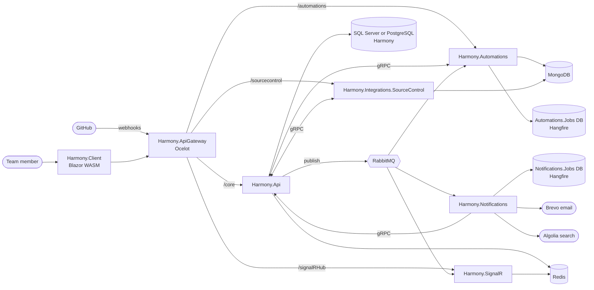

# Architecture overview: Harmony

> The current state of the system. Update it in the same pull request as any change that alters what is written here. Marked "(inferred - confirm)" where it was derived from code and not yet confirmed by the team.

## Purpose and context

Harmony is a free, self-hosted project management tool: Kanban boards, Scrum projects with sprints and retrospectives, automations, and a GitHub integration, with instant updates across connected clients (README). Users work in a Blazor WebAssembly client; everything server-side is a set of .NET 10 services behind an Ocelot API gateway.

## Building blocks

Dependencies are project references taken from the `.csproj` files.

| Project | Responsibility | Depends on |
|---|---|---|
| `Core/Harmony.Domain` | Entities and enums | - |
| `Core/Harmony.Application` | CQRS commands/queries (MediatR), FluentValidation, AutoMapper, gRPC protos, broker constants, contracts | Domain, Shared |
| `Core/Harmony.Application.SourceControl` | Source-control features (branches, pushes, pull requests) | Application |
| `Shared/Harmony.Shared` | Constants, localization, helpers shared with the client | - |
| `Infrastructure/Harmony.Persistence` | EF Core `HarmonyContext`, ASP.NET Identity, JWT bearer | Application, Domain |
| `Infrastructure/Harmony.Persistence.Migrations.SqlServer` / `.PostgreSql` | EF Core migrations per database provider | Persistence |
| `Infrastructure/Harmony.Infrastructure` | Repositories (EF Core, Dapper, MongoDB driver), Algolia, gRPC clients | Application, Persistence |
| `Infrastructure/Harmony.Messaging` | RabbitMQ publisher (`notifications` topic exchange), RabbitMQ health check | Application |
| `Infrastructure/Harmony.Caching` | EasyCaching, in-memory or Redis (`CacheProvider`) | Application |
| `Infrastructure/Harmony.Logging` | Serilog configuration, optional Elasticsearch sink | - |
| `Services/Harmony.Api` | Core REST API (controllers) and gRPC server (Card, UserCard, Board, Workspace, User, UserNotification services); owns the Harmony database; migrates and seeds it at startup | ServiceDefaults, Application, Caching, Infrastructure, Logging, Messaging, Persistence (+ migrations) |
| `Services/Harmony.Automations` | Automation rules in MongoDB, Hangfire jobs, gRPC `AutomationService`; consumes `notifications.automation` | ServiceDefaults, Application, Caching, Infrastructure, Logging, Messaging, migrations, Shared |
| `Services/Harmony.Notifications` | Email notifications (Brevo) and search-index updates via Hangfire; consumes `email_notifications` and `search_index_notifications` | ServiceDefaults, Application, Infrastructure, Logging, Messaging, Persistence (+ migrations) |
| `Services/Harmony.SignalR` | SignalR hub for real-time updates; Redis backplane; consumes `notifications.signalr` | ServiceDefaults, Application, Application.SourceControl, Logging, Messaging |
| `Integrations/Harmony.Integrations.SourceControl` | GitHub webhook endpoint (`GithubController`), source-control activity in MongoDB, gRPC `SourceControlService` | ServiceDefaults, Application(.SourceControl), Infrastructure, Logging, Messaging, Persistence |
| `ApiGateways/Harmony.ApiGateway` | Ocelot routing (`ocelot.json`, `ocelot.docker.json`) and aggregated Swagger | ServiceDefaults |
| `Web/Harmony.Client` + `Harmony.Client.Infrastructure` | Blazor WebAssembly UI (MudBlazor), JWT auth state in local storage, SignalR client; calls only `gatewayUrl` | Application, Application.SourceControl, Shared |
| `Aspire/Harmony.AppHost` | Local orchestration of containers and services, startup order | all hosts |
| `Aspire/Harmony.ServiceDefaults` | OpenTelemetry, service discovery, HTTP resilience, default health checks | - |

## Key flows

1. **A user changes a card.** The client calls the gateway (`/core/...`), which routes to `Harmony.Api`. A MediatR command handler in `Harmony.Application` updates the Harmony database and publishes a message to the `notifications` topic exchange in RabbitMQ.
2. **Fan-out of that change.** `Harmony.SignalR` consumes `notifications.signalr` and pushes the update to connected clients (Redis backplane). `Harmony.Automations` consumes `notifications.automation` and runs matching automations (for example sum up story points, sync parent and child issues), calling back into the Api over gRPC. `Harmony.Notifications` consumes `email_notifications` (emails via Brevo) and `search_index_notifications` (Algolia index).
3. **GitHub activity.** GitHub posts webhooks to `Harmony.Integrations.SourceControl` (through the gateway, `/sourcecontrol/...`) (inferred - confirm). It stores branches, pushes and pull requests in MongoDB and publishes broker events; the Api reads source-control data over gRPC.

## Data

- **Harmony database** (SQL Server or PostgreSQL, chosen by `DatabaseProvider`): owned by `Harmony.Api` through EF Core `HarmonyContext` and ASP.NET Identity. Migrations live in the two `Persistence.Migrations.*` projects and are applied at Api startup (`Database.Migrate()`), followed by seeding (default users).
- **Harmony.Automations.Jobs** and **Harmony.Notifications.Jobs** (same provider): Hangfire storage plus the services' own EF contexts (`AutomationContext`, `NotificationContext`), migrated at each service's startup.
- **MongoDB**: automation rules (Automations) and source-control activity (SourceControl).
- **Redis**: distributed cache (`CacheProvider=Redis`) and SignalR backplane.
- **Files**: card attachments are served from the Api's `Files/` folder (static files) (inferred - confirm).
- Retention: not defined in code.

## Integrations

| Direction | Counterpart | Mechanism | Owner |
|---|---|---|---|
| Inbound | Blazor client | REST + SignalR through the Ocelot gateway | Api, SignalR |
| Inbound | GitHub | Webhooks (`GithubController`) | Integrations.SourceControl |
| Internal | Api <-> Automations, Api <-> SourceControl, Notifications -> Api | gRPC (HTTPS, server certificate validation disabled) | each service |
| Internal | Api, SourceControl -> Automations, Notifications, SignalR | RabbitMQ: topic exchange `notifications`; queues `notifications.automation`, `notifications.signalr`, `email_notifications`, `search_index_notifications` | Messaging |
| Outbound | Brevo | Transactional email API (`BrevoSettings`); `GmailSettings` is also bound | Notifications |
| Outbound | Algolia | Search index (`AlgoliaConfiguration`); the Api itself searches the database (`SearchEngine.Database`) | Notifications |

## Cross-cutting concerns

- **Authentication and authorization:** ASP.NET Identity users in the Harmony database; the Api issues and validates JWT bearer tokens (`AppConfiguration:Secret`). The gateway has no `AuthenticationOptions` on its routes, so it forwards without validating tokens, and Automations, Notifications, SignalR and SourceControl do not configure authentication (inferred - confirm). The Api enforces its own rules ([ADR 2026-11-27-api-authorization-model](../adr/2026-11-27-api-authorization-model.md), #25):
  - **Login-required default.** An authorization fallback policy (`AddJwtAuthentication`) requires an authenticated user on every endpoint the Api routes, including ones without an attribute and requests that match no endpoint. Anonymous: 401 with the result envelope `["You are not Authorized."]`; expired login: 401 with `["The Token is expired."]`.
  - **Explicitly anonymous, and nothing else:** the six public endpoints (`POST api/identity/token`, `POST api/identity/token/refresh`, `POST api/identity/user`, `GET api/identity/user/confirm-email`, `POST api/identity/user/forgot-password`, `POST api/identity/user/reset-password`; `[AllowAnonymous]`), `/healthz/ready` and `/healthz/live`, the `/Error` page that the exception handler re-runs, and the six gRPC services (`.AllowAnonymous()` in `Program.cs`, until R-09).
  - **Middleware that answers before routing, so the fallback policy does not apply:** CORS preflight (`UseCors` runs first), the web root's static files and `/Files` (R-13), and in Development only the API explorer (`/swagger`).
  - **Administration by permission.** The 8 role and user administration actions require their permission policy (for example `Permissions.Roles.View`); renaming a role also needs `Permissions.Roles.Edit`. The seeder gives the `Administrator` role every permission at startup. A missing permission gets 403 with `["You are not authorized to access this resource."]`.
  - **Own data from the login.** `GET api/identity/account` and `GET api/UserNotifications` read the caller's own data from the token's name-identifier claim. No REST endpoint reads another user's data by ID outside administration and resource scopes.
- **Observability:** `Harmony.ServiceDefaults` adds OpenTelemetry traces, metrics and logs (OTLP, the Aspire dashboard locally); Serilog writes to the console and optionally Elasticsearch (`ElasticConfiguration:Uri`, empty disables it). Every service exposes `/healthz/ready` (database, RabbitMQ or MongoDB checks) and `/healthz/live`.
- **Resilience:** Polly retry policies (`AddRetryPolicies`), `Microsoft.Extensions.Http.Resilience` from ServiceDefaults; the RabbitMQ publisher connects in the background with wait-and-retry.
- **Configuration and secrets:** `appsettings.json` / `appsettings.Production.json` per service with sections `ConnectionStrings`, `DatabaseProvider`, `BrokerConfiguration`, `MongoDB`, `RedisConnectionString`, `CacheProvider`, `AppEndpointConfiguration`, `AppConfiguration`, `AlgoliaConfiguration`, `BrevoSettings`, `GmailSettings`, `ElasticConfiguration`. Under Aspire, the AppHost injects these as environment variables and keeps generated passwords in its user secrets (`Parameters:*`). Docker Compose reads secrets from `.env` (see `.env.example`).
- **Localization:** resource files (`Resources/`) on the Api and SourceControl; the client picks the culture from stored preferences.

## Deployment

- **Local:** `aspire run` (or `dotnet run --project src/Aspire/Harmony.AppHost`) starts SQL Server or PostgreSQL, MongoDB, RabbitMQ, Redis and optionally Elasticsearch + Kibana as persistent containers with named volumes (`harmony-*-data`), then every service in dependency order (`WaitFor`). `Harmony:DatabaseProvider` selects `SqlServer` (default), `PostgreSQL` or `LocalSqlServer`. The client runs at https://localhost:7096.
- **Containers:** each host has a `Dockerfile`; `docker-compose.yml` (SQL Server) and `docker-compose.postgres.yml` (PostgreSQL override) run the full stack with an Aspire dashboard container.
- **Kubernetes:** Kustomize base in `.k8s/base` (apps and infra) with `sqlserver` and `postgres` overlays (`kubectl apply -k .k8s/overlays/<provider>`).
- **CI/CD:** `.github/workflows/ci.yml` builds, tests and format-checks every pull request to `develop`, `main` and `release/**` (job `Build and test`). A separate job, `Integration tests`, runs in parallel on the same triggers: it runs the integration test command (AGENTS.md) against SQL Server, PostgreSQL and MongoDB containers on the runner's Docker, then the Api test command (Api host and authorization matrix, on a PostgreSQL container), and publishes the results and coverage of both. These workflows sit next to the SDLC workflows (`sdlc-gates.yml`, `copilot-setup-steps.yml`). There is no release pipeline. Agent evals are not run in CI; run them locally with `./evals/run-evals.ps1`. How releases reach production and how they are rolled back is not described in the repository (inferred - confirm).

## Known issues and technical debt

Recorded from one run on 2026-11-25 (`dotnet build Harmony.slnx`, SDK 10.0.404); not fixed in the setup branch.

- **Unit tests cover only part of the Application layer** (added 2026-11-26, #5). `tests/Harmony.Application.UnitTests` (xUnit v3 on Microsoft.Testing.Platform, see the testing-strategy ADR) covers:
  - the card helpers, the issue-type filter and the query-filter builder;
  - the six AutoMapper mappings with custom rules, plus a ratchet on the 28 unmapped members;
  - one reference handler test (`UpdateCardTitleCommandHandler`).

  The CI workflow (`.github/workflows/ci.yml`, R-02) builds and runs them on every pull request. Still missing: tests against the broker, the other services and the Blazor client.
- **Resource endpoints are open to any logged-in user; the authorization matrix pins each gap** (added 2026-11-26, #22; updated 2026-11-27, #25). `tests/Harmony.Api.IntegrationTests` runs `Harmony.Api`'s own startup in memory on a throwaway PostgreSQL database (needs Docker, see AGENTS.md). It checks every controller action against [the matrix file](../../tests/Harmony.Api.IntegrationTests/Authorization/authorization-matrix.md), which states each endpoint's scope and its known gaps:
  - **No endpoint lets an anonymous caller in** except the six public ones (anonymous baseline 0). #25 closed the 94 gaps with the login-required default (Cross-cutting concerns).
  - **All 80 resource endpoints let a logged-in user who is not a member act on another user's workspace or board** (R-08).
  - **The 8 administration endpoints refuse a logged-in user without their permission** with 403 (the matrix's admin rule, no known gaps).

  A new endpoint fails the tests until its line states its scope, and a closed gap fails until its mark is removed. The six gRPC services, the health checks, the API explorer and the `/Files` static files are outside the matrix, with their own tests where they are routed (R-09, R-13). The everyday test command does not run these tests; the `Integration tests` CI job does.
- **The six gRPC services are reachable without a login** (added 2026-11-27, #25). Automations and Notifications call them without a token, so they are explicitly anonymous until R-09 adds service authentication. Anyone who reaches the Api's own port can read users (with emails), boards, cards and workspaces, move a card, sync story points and add a card member. None of them touches roles, permissions or role membership. The gateway forwards `/core/{everything}` over HTTP/1.1, which gRPC cannot use, so they are not reachable through the gateway (inferred - confirm).
- **Compose and Kubernetes run every service as Development** (added 2026-11-27, #25). `docker-compose.yml` and `.k8s/base/kustomization.yaml` set `ASPNETCORE_ENVIRONMENT=Development`. There, the Api's API explorer is still served, and the exception handler and HSTS are skipped. In Production, the gateway's aggregated Swagger (MMLib.SwaggerForOcelot) cannot load the core API's section, because the Api serves `swagger/v1/swagger.json` only in Development. A roadmap item ("Later") tracks running these deployments as Production.
- **Permission changes take effect only with a new token** (added 2026-11-27, #25). Permissions travel in the login, so a user who loses a permission keeps it until their token expires or is refreshed (access tokens live two days; R-11).
- **A user with `Permissions.Users.Edit` can grant themselves any role except `Administrator`** (added 2026-11-27, #25), including a custom role with more permissions. Only an administrator can add or remove the `Administrator` role. Today only `Administrator` holds permissions, so the risk appears once an administrator delegates; a stricter rule (granting only roles whose permissions you hold) would be a new roadmap item.
- **A user with `Permissions.RoleClaims.Edit` who is not an administrator can set any role's permissions** (added 2026-11-27, #25), including `Basic`, their own custom role and `Administrator`. `RoleService.UpdatePermissionsAsync` refuses changes to the `Administrator` role only when the caller *is* an administrator, and checks no other role. The same delegation risk as the `Users.Edit` entry above, and the same stricter rule would close it.
- **Integration tests cover the data layer only** (added 2026-11-26, #19). `tests/Harmony.Infrastructure.IntegrationTests` runs against throwaway SQL Server, PostgreSQL and MongoDB containers (Testcontainers; needs Docker, see AGENTS.md). It covers:
  - the migrations of `HarmonyContext`, `AutomationContext` and `NotificationContext` on both providers, and a check that no model change lacks a migration;
  - board load, board access and the user's board list, backlog reorder (#11), workspace card search (#17) and card repository counts and positions, on both providers;
  - the MongoDB automation and source-control stores.

  The everyday test command does not run them; the `Integration tests` CI job does. They pin these known-wrong behaviours, each with a `_KnownIssue` test named in [the roadmap](../roadmap.md) (Later, "Known defects found by R-03"):
  - loading a board ignores the cards-per-list limit (R-22);
  - a board-access check for an unknown board throws instead of refusing access (R-08);
  - workspace card search is case-sensitive on PostgreSQL and case-insensitive on SQL Server;
  - the next card serial number is a count of the board's cards, so it would repeat if a card were deleted (R-22).
- **675 build warnings, 0 errors** on a clean build, on Windows and Linux: 585 from code and 90 NuGet audit warnings (NU1903, see below). CI fails a pull request whose code warnings exceed the baseline of 585. NuGet warnings are reported but not counted, because they depend on the live advisory database. The count includes duplicates: the unused-import warnings in `automations.proto` are reported once per project that compiles it, and NU1903 once per project and once for the solution. Mostly nullable reference types (CS8618 x262, CS8602 x136, CS8632, CS8604, CS8625, CS8600, CS8603, CS8601), plus unused fields (CS0169, CS0414), CA2022 (inexact `Stream.ReadAsync` in `Account.razor.cs` and `EditCardModal.razor.cs`) and MUD0002 (attribute casing in `Board.razor`).
- **Vulnerable package:** `AutoMapper` 14.0.0 raises NU1903 for three high-severity denial-of-service advisories: [GHSA-rvv3-g6hj-g44x](https://github.com/advisories/GHSA-rvv3-g6hj-g44x), [GHSA-6vhm-j9h7-f9gh](https://github.com/advisories/GHSA-6vhm-j9h7-f9gh) and [GHSA-gpwp-5797-mjff](https://github.com/advisories/GHSA-gpwp-5797-mjff). The fixes are only in the commercially licensed 15.1.x and 16.x releases.
  - Replacing AutoMapper is R-14.
  - `tests/Directory.Build.props` suppresses the three advisories for test projects only, so `TreatWarningsAsErrors` can stay on there. `src/` projects still report them.
- **Formatting:** `dotnet format --verify-no-changes` fails with 1,017 whitespace diagnostics in 220 files; there is no `.editorconfig`.
- **gRPC clients accept any server certificate** (`DangerousAcceptAnyServerCertificateValidator`) in the Api and Automations.
- **CORS allows any origin with credentials** (`SetIsOriginAllowed(_ => true)`) in the Api, SignalR and the gateway.
- **Unused SQL Server-only code:** `BoardService.LoadBoardOld` / `LoadBoardListCardsOld` (stored procedures through `SqlConnection`) and `AddHarmonyDatabase` in `Harmony.Notifications` are never called; they would fail on PostgreSQL.

## Decision index

| ADR | Decision | Status |
|---|---|---|
| [2026-11-25-microservices-grpc-and-rabbitmq](../adr/2026-11-25-microservices-grpc-and-rabbitmq.md) | Microservices behind an Ocelot gateway; gRPC for queries, RabbitMQ for events | accepted |
| [2026-11-25-sql-server-and-postgresql](../adr/2026-11-25-sql-server-and-postgresql.md) | Support SQL Server and PostgreSQL with one migrations project per provider | accepted |
| [2026-11-25-aspire-local-orchestration](../adr/2026-11-25-aspire-local-orchestration.md) | .NET Aspire for local orchestration and observability; Compose and Kubernetes for deployment | accepted |
| [2026-11-26-testing-strategy](../adr/2026-11-26-testing-strategy.md) | xUnit v3 on Microsoft.Testing.Platform with NSubstitute, Shouldly and coverlet.MTP; tests in a separate `tests/` tree | accepted (rule 7 superseded in part) |
| [2026-11-26-test-traceability-tags](../adr/2026-11-26-test-traceability-tags.md) | Every test carries a `Requirement` trait, or a `Bug` trait for a Track S bug fix; one shared guard in `tests/Shared/` | accepted |
| [2026-11-27-api-authorization-model](../adr/2026-11-27-api-authorization-model.md) | The core API requires a login by default (fallback policy), opens endpoints only by explicit marker, and guards administration with permission policies | accepted (R-07, #25) |
